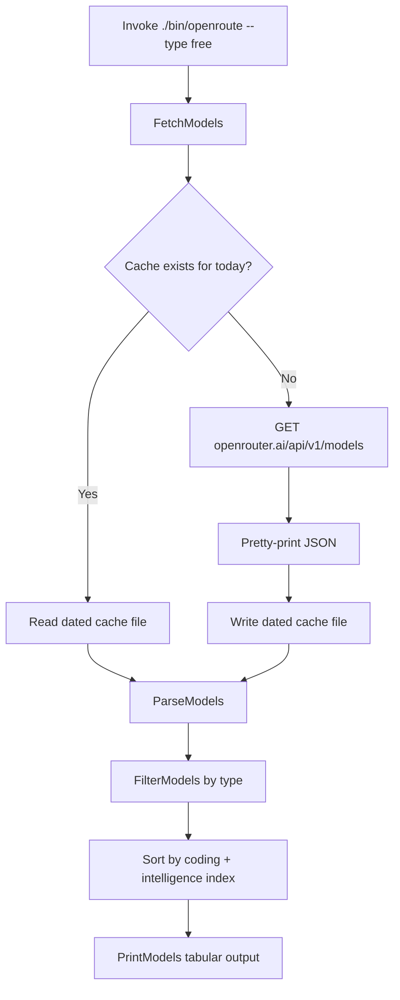

# FLOW — `openroute` CLI

This document describes the end-to-end workflow of the `openroute` command,
from invocation to tabular output.

## Overview



## Step-by-Step

### 1. Invocation

`cmd/openroute/main.go` parses the `--type` flag (default `free`) and calls
`openroute.FetchModels()`.

### 2. Fetch with Cache (`packages/openroute/client.go`)

- Cache path: `os.TempDir() + "/" + time.Now().Format("020106") + "-model_list.json"`
  (e.g. `151026-model_list.json` for Oct 15, 2026).
- If the file already exists, it is read and returned — **no network call**.
- Otherwise:
  1. `GET https://openrouter.ai/api/v1/models`
  2. Verify `200 OK`
  3. Pretty-print the JSON (`json.MarshalIndent`)
  4. Write to the cache file with mode `0644`
- Returns the raw JSON bytes and the cache path.

### 3. Parse (`ParseModels`)

Unmarshals the raw JSON into a `ModelResponse` (a `data []Model` envelope).
Fields of interest: `id`, `name`, `pricing.prompt`, `pricing.completion`,
`context_length`, and `benchmarks.artificial_analysis`
(`coding_index`, `intelligence_index`, `agentic_index`).

### 4. Filter (`FilterModels`)

- `--type all` → keep every model.
- `--type free` (default) → keep only models whose `id` ends with `:free`.

### 5. Sort

Models are sorted descending by `coding_index + intelligence_index`
(0 when benchmarks are absent).

### 6. Print (`PrintModels`)

Outputs a fixed-width table with columns:

`ID | NAME | CODING_INDEX | INTELL_INDEX | SUM | PROMPT | COMPLETION | CONTEXT`

- Benchmark cells show `-` when no Artificial Analysis data exists.
- Prices are scaled from per-token to **per-million-token** cost
  (`price * 1e6`, formatted to 4 decimals).

## Data Flow Diagram

```
OpenRouter API ──GET──▶ FetchModels ──cache──▶ dated JSON file
                        │
                        ▼
                    ParseModels ──▶ ModelResponse
                        │
                        ▼
                    FilterModels ──▶ []Model (free | all)
                        │
                        ▼
                    sort by score ──▶ PrintModels ──▶ stdout table
```

## Cache Behavior

| Condition                          | Behavior                                        |
| ---------------------------------- | ----------------------------------------------- |
| Cache file for today exists        | Reused; no network request                      |
| Cache file missing / fetch fails   | Fresh `GET` + pretty-print + write              |
| Cache write fails                  | Error returned, command exits with message      |
