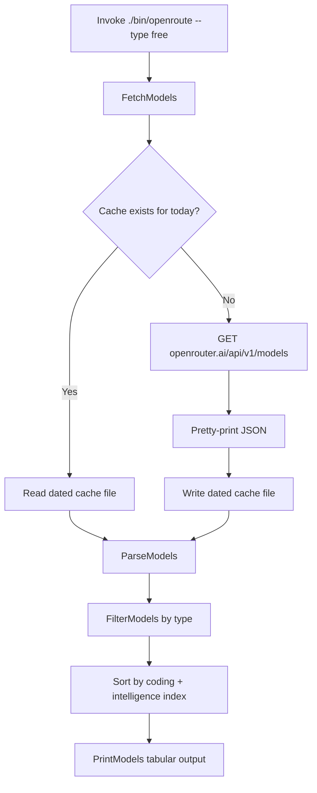

# FLOW — go-utils CLI Tools

This document describes the end-to-end workflows for both CLI tools:

- [`openroute`](#openroute-cli) — fetches and displays OpenRouter model listings
- [`vultrcli`](#vultrcli-cli) — manages Vultr cloud instances

## Overview — `openroute` CLI



## Overview — `vultrcli` CLI

```mermaid
flowchart TD
    A[Invoke ./bin/vultrcli --action create|destroy] --> B{Action?}
    B -- create --> C[Load .env config]
    C --> D[GetSnapshotID by name]
    D --> E[GetSSHKeyID by name]
    E --> F[getMaxWorkerID for unique label]
    F --> G[vultr-cli instance create]
    G --> H[Log created instance]
    B -- destroy --> I[Load .env config]
    I --> J[ensureNoPendingJobs via job-stats API]
    J -- Jobs pending --> K[Abort: refusing to destroy]
    J -- No jobs --> L[listWorkerInstances]
    L --> M{Instance ready?}
    M -- No --> N[Skip instance]
    M -- Yes --> O[vultr-cli instance delete]
    O --> P[Log destroyed/skipped counts]
```

## Step-by-Step

### 1. Invocation

`cmd/openroute/main.go` parses the `--type` flag (default `free`) and calls
`openroute.FetchModels()`.

### 2. Fetch with Cache (`packages/openroute/client.go`)

- Cache path: `os.TempDir() + "/" + time.Now().Format("020106") + "-model_list.json"`
  (e.g. `151026-model_list.json` for Oct 15, 2026).
- If the file already exists, it is read and returned — **no network call**.
- Otherwise:
  1. `GET https://openrouter.ai/api/v1/models`
  2. Verify `200 OK`
  3. Pretty-print the JSON (`json.MarshalIndent`)
  4. Write to the cache file with mode `0644`
- Returns the raw JSON bytes and the cache path.

### 3. Parse (`ParseModels`)

Unmarshals the raw JSON into a `ModelResponse` (a `data []Model` envelope).
Fields of interest: `id`, `name`, `pricing.prompt`, `pricing.completion`,
`context_length`, and `benchmarks.artificial_analysis`
(`coding_index`, `intelligence_index`, `agentic_index`).

### 4. Filter (`FilterModels`)

- `--type all` → keep every model.
- `--type free` (default) → keep only models whose `id` ends with `:free`.

### 5. Sort

Models are sorted descending by `coding_index + intelligence_index`
(0 when benchmarks are absent).

### 6. Print (`PrintModels`)

Outputs a fixed-width table with columns:

`ID | NAME | CODING_INDEX | INTELL_INDEX | SUM | PROMPT | COMPLETION | CONTEXT`

- Benchmark cells show `-` when no Artificial Analysis data exists.
- Prices are scaled from per-token to **per-million-token** cost
  (`price * 1e6`, formatted to 4 decimals).

## Data Flow Diagram

```
OpenRouter API ──GET──▶ FetchModels ──cache──▶ dated JSON file
                        │
                        ▼
                    ParseModels ──▶ ModelResponse
                        │
                        ▼
                    FilterModels ──▶ []Model (free | all)
                        │
                        ▼
                    sort by score ──▶ PrintModels ──▶ stdout table
```

## Cache Behavior

| Condition                          | Behavior                                        |
| ---------------------------------- | ----------------------------------------------- |
| Cache file for today exists        | Reused; no network request                      |
| Cache file missing / fetch fails   | Fresh `GET` + pretty-print + write              |
| Cache write fails                  | Error returned, command exits with message      |

---

## `vultrcli` CLI — Step-by-Step

### 1. Invocation

`cmd/vultrcli/main.go` parses flags:

- `--action` (required): `create`, `delete`, `destroy`
- `--size`: `high`, `medium`, `small` (default `small`)
- `--img`: snapshot image name (default `retranscode-worker`)
- `--ssh-name`: SSH key name (default `vultr-dev-access`)
- `--api-key`: API key for job-stats (or `$API_KEY` env)

Loads `.env` via `config.NewEnv().LoadEnv()` and initializes logger.

### 2. Create Action (`CreateAction`)

1. **Resolve snapshot** — `GetSnapshotID()` calls `vultr-cli snapshot list -o json`, filters by description.
2. **Resolve SSH key** — `GetSSHKeyID()` calls `vultr-cli ssh-key list -o json`, filters by name.
3. **Generate unique label** — `getMaxWorkerID()` lists existing workers (`<WORKER_LABEL>-<N>`), returns max N + 1.
4. **Create instance** — `vultr-cli instance create` with region, plan, snapshot, SSH key, label.
5. **Log result** — outputs instance details.

### 3. Destroy Action (`DestroyAction`)

1. **Check job stats** — `ensureNoPendingJobs()`:
   - Requires `--api-key` or `$API_KEY`
   - `GET $JOB_STATS_URL?api_key=...`
   - If `accepted + draft > 0` or `jobs` non-empty → **abort**
2. **List worker instances** — `listWorkerInstances()` filters by label prefix `<WORKER_LABEL>-`.
3. **Check readiness** — `isReady()` requires:
   - `status == "active"`
   - `power_status == "running"`
   - `server_status == "ok"`
4. **Delete ready instances** — `deleteInstance()` calls `vultr-cli instance delete <id>`.
5. **Log summary** — counts destroyed vs skipped.

## Data Flow Diagram — `vultrcli`

```
create:
  .env ──▶ config ──▶ GetSnapshotID ──▶ snapshot ID
                    │
                    ├─▶ GetSSHKeyID ──▶ ssh key ID
                    │
                    ├─▶ getMaxWorkerID ──▶ next worker N
                    │
                    ▼
              vultr-cli instance create ──▶ new instance

destroy:
  .env + API_KEY ──▶ ensureNoPendingJobs ──▶ (abort if jobs pending)
                                    │
                                    ▼
                            listWorkerInstances ──▶ []Instance
                                    │
                                    ▼
                              filter isReady() ──▶ ready instances
                                    │
                                    ▼
                            vultr-cli instance delete ──▶ destroyed
```

## Job-Stats Guard

| Condition                          | Behavior                                        |
| ---------------------------------- | ----------------------------------------------- |
| `accepted + draft > 0`             | Abort destroy; error returned                   |
| `jobs` array non-empty             | Abort destroy; error returned                   |
| All zero / empty                   | Proceed to instance destruction                 |
| API key missing                    | Error: "missing API key"                        |
| Job-stats HTTP error               | Error with status code                          |
